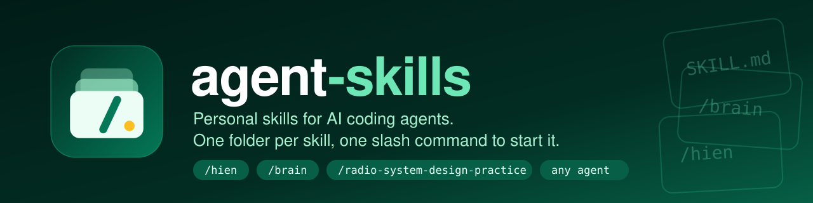

<p align="center">
  
</p>

# Agent Skills

Personal skills for AI coding agents. Layout matches the [Agent Skills](https://github.com/addyosmani/agent-skills) pack: one directory per skill, slash commands as entry points, plugin manifests for Claude Code / Cursor.

```
  HIEN                         PRACTICE
 ┌──────────────────────────┐ ┌──────────────────────────────────┐
 │  Think and build         │ │  RADIO system design coaching    │
 │  like Hien               │ │  one question → lock → next      │
 └──────────────────────────┘ └──────────────────────────────────┘
  /hien                        /radio-system-design-practice
```

## Commands

| What you're doing | Command | Key principle |
|---|---|---|
| Capture your voice and taste from your own writing, then write and think in it | `/twin` | Evidence or nothing |
| Think and build with Hien's tools, opinions, and voice | `/hien` | Hien's public `twin` profile |
| Practice a frontend system design interview | `/radio-system-design-practice` | RADIO, one question at a time |
| Build or drill a behavioral story (Amazon LP loops and others) | `/behavioral-story-depth` | Short opener, deep Actions, no invented facts |
| Search your notes and long-term memory | `/brain` | Ranked search first, rephrase before giving up |

## Quick start

**Cursor** — this repo already maps `skills/` into `.cursor/skills/` (symlink). Open the repo, or add it as a project skill pack.

**Claude Code**

```
/plugin marketplace add https://github.com/phuhien92/agent-skills.git
/plugin install agent-skills@agent-skills
```

Then run `/hien` or `/radio-system-design-practice`.

**Any agent (skills CLI)**

```bash
npx skills add phuhien92/agent-skills --skill twin
npx skills add phuhien92/agent-skills --skill hien
npx skills add phuhien92/agent-skills --skill radio-system-design-practice
npx skills add phuhien92/agent-skills --skill behavioral-story-depth
npx skills add phuhien92/agent-skills --skill brain   # needs the brain CLI: npm install -g github:phuhien92/brain-cli
```

## Skills

| Skill | What it does | Use when |
|---|---|---|
| [twin](skills/twin/SKILL.md) | Scans your own posts, docs, and notes into an evidence-backed profile (voice, taste, opinions, work), then writes, reviews, and answers in it. Refresh merges new material and flags changes of mind. | Writing that sounds like you, "what would I think?", keeping a personal voice profile |
| [hien](skills/hien/SKILL.md) | Hien Luong's (Raymond) public profile for `twin`: voice, beliefs, and work. | `/hien`, or when asked how Hien thinks, builds, or solves problems |
| [brain](skills/brain/SKILL.md) | Searches and updates your markdown vault (Obsidian or similar) through the [brain CLI](https://github.com/phuhien92/brain-cli): ranked search, notes by name, one-file-per-entry memory that syncs across machines. | Questions about your notes, past decisions or preferences; recording a lesson worth keeping. Requires the CLI |
| [radio-system-design-practice](skills/radio-system-design-practice/SKILL.md) | Coaches RADIO (Requirements → Architecture → Data model → Interfaces → Optimizations). Hidden rubric, one question, score, lock, next. | System design practice, news feed / autocomplete / docs / chat, `@solution.md` or an Excalidraw board |
| [behavioral-story-depth](skills/behavioral-story-depth/SKILL.md) | Turns a real story into a 75–90s opener plus a deep Actions layer that survives ~5 min of probing; maps stories to Amazon LPs; drills follow-ups. | "Tell me about a time…" prep, Amazon LP loops, a story that collapses on follow-up |

## Project structure

```
agent-skills/
├── skills/
│   ├── brain/
│   │   └── SKILL.md           # source of truth: phuhien92/brain-cli
│   ├── twin/
│   │   └── SKILL.md
│   ├── hien/
│   │   ├── SKILL.md
│   │   ├── work.md
│   │   ├── beliefs.md
│   │   └── voice.md
│   ├── radio-system-design-practice/
│   │   ├── SKILL.md
│   │   └── examples.md
│   └── behavioral-story-depth/
│       ├── SKILL.md
│       └── probes.md
├── .claude/commands/          # Claude Code slash commands
├── .cursor/skills/            # Cursor: symlink to skills/
├── commands/                  # Extra slash-command copies
├── .claude-plugin/plugin.json
├── plugin.json
└── docs/
```

## How a skill is shaped

Each skill is a workflow, not a dump of notes:

- YAML frontmatter: `name` + `description` (what + when)
- Steps the agent must follow
- Supporting files loaded only when needed (`examples.md`, or profile files)

`/hien` is a worked example of a `twin` profile: its files sit next to the skill so it installs on its own. Your own profile lives outside this repo, in `~/.twin/<name>/` by default.

## Checks

```bash
python3 tools/validate.py   # wiring + structure, runs in CI
```

Behavior cases live in `evals/`. See [ARCHITECTURE.md](ARCHITECTURE.md) for the layout and rules.

## License

MIT
