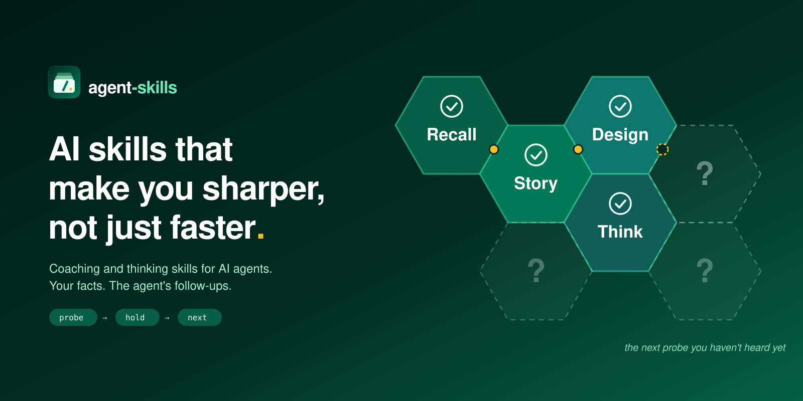

<p align="center">
  
</p>

# Agent Skills

**Agent skill blocks for software factories.** Factories automate the build. These blocks train the part that stays human: recalling the real facts, thinking a problem through, defending a decision under follow-up, and checking what the agents decided for you. Each skill is a folder with a slash command, and runs in Claude Code, Cursor, or any agent that reads `SKILL.md`.

```bash
npx skills add phuhien92/agent-skills
```

`/brain` also needs the [brain CLI](https://github.com/phuhien92/brain-cli): `npm install -g github:phuhien92/brain-cli`.

## Why

A software factory makes output cheap. Someone still has to set the intent and judge the result. That person gets tested the same way in interviews and in real work: does the answer hold up on the second follow-up? "What did *you* do?" "What else did you consider?" "How did you know it worked?" A polished answer with nothing underneath falls apart right there.

The practice skills work the other way around. They start at the second follow-up. They probe one question at a time, hold you to what you answered, and only then move on. Nothing gets invented along the way. A missing metric or name becomes a question for you, never a placeholder that reads like the truth.

The agent does the grinding: it asks, probes, and checks your work. You do the part only you can do: supply the real facts and judge the result.

## How to use

Run a full prep loop, or grab one skill when you need it. None of them depends on another.

### The full loop: prep for an interview loop

1. **Recall.** `/brain` on the role or company. Pull past projects, decisions, and wins out of your notes so you start from facts, not memory.
2. **Build the stories.** `/behavioral-story-depth` on each real story. You get a 75 to 90 second opener plus a deep Actions layer. Then use Map mode to spread your stories across the loop's Leadership Principles.
3. **Drill the follow-ups.** Run the same skill in Drill mode. It asks 4 to 6 follow-ups, one at a time, then names the slips that keep repeating.
4. **Practice the design round.** `/radio-system-design-practice` on a classic prompt. RADIO, one question at a time, scored and locked before the next.

Your time goes into the facts in step 1 and the answers in steps 2 to 4. The skill keeps the pressure on in between.

### À la carte

- **Think a problem through.** `/think-with-me` loads my tools, opinions, and voice, then helps you think and build the way I would.
- **"Did I already decide this?"** `/brain` searches your notes before the agent answers from general knowledge.
- **One story keeps collapsing.** `/behavioral-story-depth` in Drill mode on just that story.
- **A feature is too big to hand over.** `/slice-spec` interviews you, then writes a spec of small slices with a pass/fail check each. Agents build from it; `/decision-checker` audits against it.
- **Is this codebase getting better or worse?** `/codebase-rubric` writes a dated scorecard with evidence you can check in under a minute, and shows what changed since the last one.
- **An agent just finished a change.** `/decision-checker` lists the calls it made where your prompt was silent, least confident first. Review that instead of the diff.

## Quick start

**Claude Code**

```
/plugin marketplace add https://github.com/phuhien92/agent-skills.git
/plugin install agent-skills@hien-skills
```

**Cursor:** this repo already maps `skills/` into `.cursor/skills/` with a symlink. Open the repo, or add it as a project skill pack.

**DeepSeek Harness:** `dsh` reads `<name>/SKILL.md` from `~/.agents/skills` (or a project's `.agents/skills`). Link the skills in from a clone:

```bash
git clone https://github.com/phuhien92/agent-skills.git ~/src/agent-skills
mkdir -p ~/.agents/skills && ln -s ~/src/agent-skills/skills/* ~/.agents/skills/
```

**Any agent (skills CLI):** install everything with the command at the top, or pick one:

```bash
npx skills add phuhien92/agent-skills --skill think-with-me
npx skills add phuhien92/agent-skills --skill radio-system-design-practice
npx skills add phuhien92/agent-skills --skill behavioral-story-depth
npx skills add phuhien92/agent-skills --skill slice-spec
npx skills add phuhien92/agent-skills --skill decision-checker
npx skills add phuhien92/agent-skills --skill codebase-rubric
npx skills add phuhien92/agent-skills --skill brain   # needs the brain CLI: npm install -g github:phuhien92/brain-cli
```

## Skills

### Practice: hold up under follow-up

| Skill | What it does | Use when |
|---|---|---|
| [behavioral-story-depth](skills/behavioral-story-depth/SKILL.md) | Turns a real story into a 75 to 90 second opener plus a deep Actions layer that survives about five minutes of probing. Maps stories to Amazon LPs and drills follow-ups. | "Tell me about a time…" prep, Amazon LP loops, a story that collapses on follow-up |
| [radio-system-design-practice](skills/radio-system-design-practice/SKILL.md) | Coaches RADIO (Requirements, Architecture, Data model, Interfaces, Optimizations). Hidden rubric, one question, score, lock, next. | System design practice, news feed / autocomplete / docs / chat, `@solution.md` or an Excalidraw board |

### Verify: measure what the factory built

| Skill | What it does | Use when |
|---|---|---|
| [codebase-rubric](skills/codebase-rubric/SKILL.md) | Writes a scorecard: files over 500, 800, and 1,000 lines, plus a 1-5 score for architecture, modularity, abstraction, components, and errors. Five independent scorers, every score backed by `path:line`, one failure traced end to end, and the change since the last scorecard. | A periodic health check, before a big refactor, or to see whether the codebase is drifting |

### Build: check what the factory decided

| Skill | What it does | Use when |
|---|---|---|
| [slice-spec](skills/slice-spec/SKILL.md) | Interviews you one question at a time, then cuts a feature into a `specs/<feature>/` folder of slices. Each slice answers one question at one seam and has a check a script can run. | Before handing a multi-step feature to agents, a plan too big to review, a slice that keeps failing mid-build |
| [decision-checker](skills/decision-checker/SKILL.md) | Lists every decision an agent made where the prompt or spec was silent, with a verdict and a confidence, least confident first. Changes no code. Drill mode quizzes you on the shakiest calls. | Before merging AI-written work, a diff too big to read, a fix that "works" but may only cover one case |

### Think and recall: start from what you know

| Skill | What it does | Use when |
|---|---|---|
| [think-with-me](skills/think-with-me/SKILL.md) | Summons Hien Luong (Raymond): loads ENTRY, TOOLS, OPINIONS, and VOICE, then helps you think and build. | `/think-with-me`, or when asked how Hien thinks, builds, or solves problems |
| [brain](skills/brain/SKILL.md) | Searches and updates your markdown vault (Obsidian or similar) through the [brain CLI](https://github.com/phuhien92/brain-cli): ranked search, notes by name, one-file-per-entry memory that syncs across machines. | Questions about your notes, past decisions or preferences; recording a lesson worth keeping. Requires the CLI |

## Project structure

```
agent-skills/
├── skills/
│   ├── brain/
│   │   └── SKILL.md           # source of truth: phuhien92/brain-cli
│   ├── think-with-me/
│   │   ├── SKILL.md
│   │   ├── ENTRY.md
│   │   ├── TOOLS.md
│   │   ├── OPINIONS.md
│   │   └── VOICE.md
│   ├── radio-system-design-practice/
│   │   ├── SKILL.md
│   │   └── examples.md
│   ├── behavioral-story-depth/
│   │   ├── SKILL.md
│   │   └── probes.md
│   ├── decision-checker/
│   │   ├── SKILL.md
│   │   ├── ledger.md
│   │   ├── harness.md
│   │   └── hooks/require-ledger.sh
│   ├── slice-spec/
│   │   ├── SKILL.md
│   │   ├── spec-format.md
│   │   └── drafting.md
│   └── codebase-rubric/
│       ├── SKILL.md
│       ├── rubric.md
│       ├── scorecard.md
│       └── scripts/           # size_report, check_scorecard, delta, and their tests
├── .claude/commands/          # Claude Code slash commands
├── .cursor/skills/            # Cursor: symlink to skills/
├── commands/                  # Extra slash-command copies
├── .claude-plugin/plugin.json
├── plugin.json
└── docs/
```

## How a skill is shaped

Each skill is a workflow, not a dump of notes:

- YAML frontmatter: `name` + `description` (what + when)
- Steps the agent must follow
- Supporting files loaded only when needed (`examples.md`, or `/think-with-me` knowledge files)

`/think-with-me` keeps ENTRY, TOOLS, OPINIONS, and VOICE next to the skill so they do not collide with other skills in this pack.

## Checks

```bash
python3 tools/validate.py   # wiring + structure, runs in CI
python3 -m unittest discover -s skills/codebase-rubric/scripts   # codebase-rubric scripts, runs in CI
```

Behavior cases live in `evals/`. See [ARCHITECTURE.md](ARCHITECTURE.md) for the layout and rules.

## License

MIT
