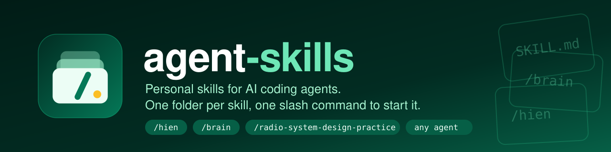

<p align="center">
  
</p>

# Agent Skills

Personal skills for AI coding agents. Layout matches the [Agent Skills](https://github.com/addyosmani/agent-skills) pack: one directory per skill, slash commands as entry points, plugin manifests for Claude Code / Cursor.

```
  HIEN                         PRACTICE
 ┌──────────────────────────┐ ┌──────────────────────────────────┐
 │  Think and build         │ │  RADIO system design coaching    │
 │  like Hien               │ │  one question → lock → next      │
 └──────────────────────────┘ └──────────────────────────────────┘
  /hien                        /radio-system-design-practice
```

## Commands

| What you're doing | Command | Key principle |
|---|---|---|
| Think and build with Hien's tools, opinions, and voice | `/hien` | Load ENTRY + knowledge files, then route |
| Practice a frontend system design interview | `/radio-system-design-practice` | RADIO, one question at a time |
| Search your notes and long-term memory | `/brain` | Ranked search first, rephrase before giving up |

## Quick start

**Cursor** — this repo already maps `skills/` into `.cursor/skills/` (symlink). Open the repo, or add it as a project skill pack.

**Claude Code**

```
/plugin marketplace add https://github.com/phuhien92/agent-skills.git
/plugin install agent-skills@agent-skills
```

Then run `/hien` or `/radio-system-design-practice`.

**Any agent (skills CLI)**

```bash
npx skills add phuhien92/agent-skills --skill hien
npx skills add phuhien92/agent-skills --skill radio-system-design-practice
npx skills add phuhien92/agent-skills --skill brain   # needs the brain CLI: npm install -g github:phuhien92/brain-cli
```

## Skills

| Skill | What it does | Use when |
|---|---|---|
| [hien](skills/hien/SKILL.md) | Summons Hien Luong (Raymond): loads ENTRY, TOOLS, OPINIONS, and VOICE, then helps you think and build. | `/hien`, or when asked how Hien thinks, builds, or solves problems |
| [brain](skills/brain/SKILL.md) | Searches and updates your markdown vault (Obsidian or similar) through the [brain CLI](https://github.com/phuhien92/brain-cli): ranked search, notes by name, one-file-per-entry memory that syncs across machines. | Questions about your notes, past decisions or preferences; recording a lesson worth keeping. Requires the CLI |
| [radio-system-design-practice](skills/radio-system-design-practice/SKILL.md) | Coaches RADIO (Requirements → Architecture → Data model → Interfaces → Optimizations). Hidden rubric, one question, score, lock, next. | System design practice, news feed / autocomplete / docs / chat, `@solution.md` or an Excalidraw board |

## Project structure

```
agent-skills/
├── skills/
│   ├── brain/
│   │   └── SKILL.md           # source of truth: phuhien92/brain-cli
│   ├── hien/
│   │   ├── SKILL.md
│   │   ├── ENTRY.md
│   │   ├── TOOLS.md
│   │   ├── OPINIONS.md
│   │   └── VOICE.md
│   └── radio-system-design-practice/
│       ├── SKILL.md
│       └── examples.md
├── .claude/commands/          # Claude Code slash commands
├── .cursor/skills/            # Cursor: symlink to skills/
├── commands/                  # Extra slash-command copies
├── .claude-plugin/plugin.json
├── plugin.json
└── docs/
```

## How a skill is shaped

Each skill is a workflow, not a dump of notes:

- YAML frontmatter: `name` + `description` (what + when)
- Steps the agent must follow
- Supporting files loaded only when needed (`examples.md`, or `/hien` knowledge files)

`/hien` keeps ENTRY, TOOLS, OPINIONS, and VOICE next to the skill so they do not collide with other skills in this pack.

## License

MIT
